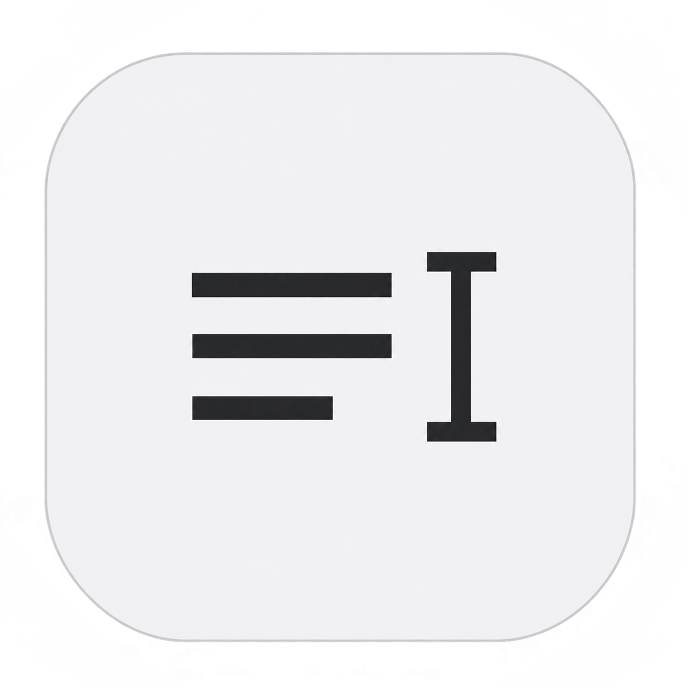
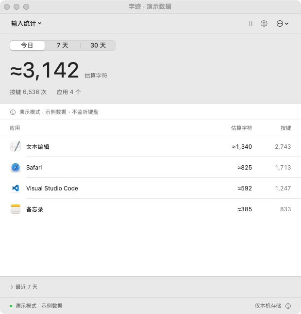
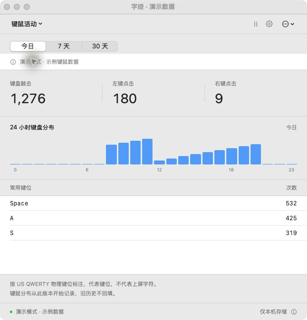

<div align="center">



# 字迹 · TypeCount

**A quiet measure of what you write.**

A small, native macOS menu bar app. See how much you type and which apps you write in.

<a href="https://github.com/JonahLee1999/TypeCount/releases/latest"></a>


<a href="LICENSE"></a>

[**Download**](https://github.com/JonahLee1999/TypeCount/releases/latest) · [Technical notes](docs/TECHNICAL-NOTES.md) · [Report an issue](https://github.com/JonahLee1999/TypeCount/issues)

[中文](README.md) · English

</div>

## Less interface, more focus

The menu bar shows a compact count such as `1.9k`. Hover for complete totals, or click for details. Closing the window keeps the app running in the menu bar.

Use the **“输入统计 ˅”** dropdown at the top left to switch between **Typing Statistics** and **Keyboard & Mouse Activity**. It opens on Typing Statistics by default; both views share the selected date range. The current app interface is in Chinese.

<table>
  <tr>
    <td width="50%"></td>
    <td width="50%"></td>
  </tr>
  <tr>
    <td align="center"><b>Typing Statistics</b><br />Input totals, app breakdown, and recent trends</td>
    <td align="center"><b>Keyboard & Mouse Activity</b><br />Keystrokes, left/right clicks, and activity distributions</td>
  </tr>
</table>

<sub>Screenshots use demo data. They contain no personal input or real usage history.</sub>

## Features

| Feature | What it shows |
| :--- | :--- |
| Compact menu bar | Today's estimated characters; optional icon, full character count, keystrokes, or mouse clicks |
| App breakdown | Estimated new characters and keystrokes, with clear labels when text cannot be read |
| Keyboard & mouse activity | Left/right clicks, 24-hour keyboard distribution, and frequently used physical keys |
| Date ranges & trends | Today, last 7 days, or last 30 days; an expandable 7-day character chart |
| Controls | Pause, exclude apps, export typing statistics as CSV, and optionally launch at login |
| Native & local | SwiftUI / AppKit, system light/dark appearance, no account, no third-party runtime dependencies |

## Get started

**Requires macOS 15.6 or later.** The universal DMG supports Apple Silicon and Intel Macs.

1. Download the latest `.dmg` from [Releases](https://github.com/JonahLee1999/TypeCount/releases/latest), then drag **字迹** into **Applications**.
2. Eject the disk image and open the app from Applications.
3. In the app's settings, grant **Accessibility (辅助功能)**, return to the app, and click **Recheck (重新检查)**.

Accessibility permits keyboard monitoring and text reading in compatible controls. Granting only **Input Monitoring** enables keystroke counts without character estimates. macOS manages these permissions; the app does not enable them automatically.

> **First launch**
>
> Current release packages use a local development certificate. They are **not signed with Apple Developer ID or notarized**. Another Mac may block the first launch because the developer cannot be verified. If you trust the download, follow the **Open Anyway** flow offered in System Settings → Privacy & Security. Managed devices may prohibit this. See [Apple's explanation](https://developer.apple.com/news/?id=saqachfa).

**Launch at login (登录时启动字迹)** is optional. When enabled, login launches the app in the menu bar without opening its main window.

## What the numbers mean

**Characters and keystrokes are separate measurements.** Character estimates come from changes to the focused text control; individual pinyin keystrokes are never directly counted as Chinese characters.

| Metric | Definition |
| :--- | :--- |
| Estimated characters | Chinese characters, English letters, punctuation, and emoji count by Swift `Character` (grapheme cluster); whitespace and line breaks are ignored |
| New input | Counts accumulate; deleting text does not subtract, replacement counts new characters, and existing text is not counted when focus changes |
| Keystrokes | Text keys, Delete, Return, Tab, and key repeats; excludes Cmd / Ctrl shortcuts, navigation keys, function keys, and standalone modifiers |
| Physical keys | Frequency by US QWERTY key position; this does not infer the characters typed |

Counts remain **estimates**: input-method composition, autocorrection, paste operations, and application-specific text interfaces can introduce errors. Where controls expose composition markers, TypeCount waits for committed text. Unsupported editors, terminals, remote desktops, very large documents, or fast focus changes may prevent character counting.

**WeChat 4.1.11:** the tested version does not expose its input area through Accessibility, so TypeCount can record keystrokes but cannot reliably count its characters. Confirmed unreadable apps show **“仅按键”** (keystrokes only); unconfirmed text access shows **“—”**. Neither means that you typed zero characters.

Further details and permission troubleshooting are available in the [technical notes](docs/TECHNICAL-NOTES.md#统计口径与准确性), currently in Chinese.

## Counts stay; words do not

Statistics stay on your Mac. The app does not save raw input, key sequences, clipboard contents, screenshots, mouse positions, or window titles, and it sends no network requests.

To estimate characters, it temporarily holds the focused editing control's text in memory. This text is cleared when focus changes, monitoring pauses or stops, an app is excluded, or protected input is detected. System secure input and recognizable password fields are skipped. Custom password fields that do not identify themselves cannot be detected universally; exclude the corresponding app when needed.

```text
~/Library/Application Support/TypeCount/
├── stats.json       # Daily typing counts grouped by app
└── activity.json    # Click totals, unordered key counts, and hourly buckets
```

Keyboard and mouse distributions retain the latest 365 days and start when that feature is enabled; older typing totals are not turned into invented key history. CSV exports contain dates and app names, so review them before sharing.

## Built to stay in the background

- Text reads follow input, focus changes, and text notifications; idle editors are not repeatedly scanned.
- Dashboard updates are combined at 500 ms intervals while visible. Hiding, minimizing, or closing the window stops list rebuilding; closing releases the main window.
- Statistics are saved in background batches every 5 seconds, with the latest data saved on normal exit.
- Mouse monitoring covers clicks, not high-frequency pointer movement. Text reads and the icon cache have explicit limits.

Resource use depends on the foreground app, document size, and input method. Use `scripts/measure-runtime.py` to measure CPU and resident memory on your own Mac.

## Build from source

Requires macOS and Xcode. Verified with **Xcode 26.3 / Swift 6.2.4 / macOS 15.6.1**; the minimum runtime is macOS 15.6.

```sh
git clone https://github.com/JonahLee1999/TypeCount.git
cd TypeCount

swift test                         # Algorithms, permission state, and storage
./scripts/build-app.sh             # App for the current architecture
open dist/TypeCount.app
```

For a universal installer and a demo preview (building the DMG also requires Python 3.10 or later):

```sh
UNIVERSAL=1 ./scripts/build-app.sh  # arm64 + x86_64
./scripts/build-dmg.sh             # DMG and SHA-256 checksum
open -n dist/TypeCount.app --args --demo
```

Demo mode uses in-memory sample data, does not monitor input, and does not change real statistics. DMG-building Python dependencies are installed only in `.build/dmg-tools` and are not shipped with the app. Their first installation requires an Internet connection; running the app does not.

Without a configured identity, builds use ad-hoc signing and may need permission again after rebuilding. Set `SIGN_IDENTITY` or a local `.signing-identity` file for a stable identity. **Never commit certificates, private keys, or signing configuration.** Developer ID signing and Apple notarization are separate distribution steps; the standard build script does not perform them.

## Contribute

Reports about editor compatibility, input methods, and simpler interactions are welcome. Include your macOS, app, and input-method versions, and reproduce issues using text without sensitive content.

[Contributing](CONTRIBUTING.md) · [Report an issue](https://github.com/JonahLee1999/TypeCount/issues/new/choose) · [Technical notes](docs/TECHNICAL-NOTES.md)

Thanks to [keyStats](https://github.com/debugtheworldbot/keyStats) for inspiration for the keyboard and mouse statistics. TypeCount implements its features independently using public system APIs and keeps estimated characters distinct from keystrokes.

---

<div align="center">

[MIT License](LICENSE) · Made for macOS

</div>
