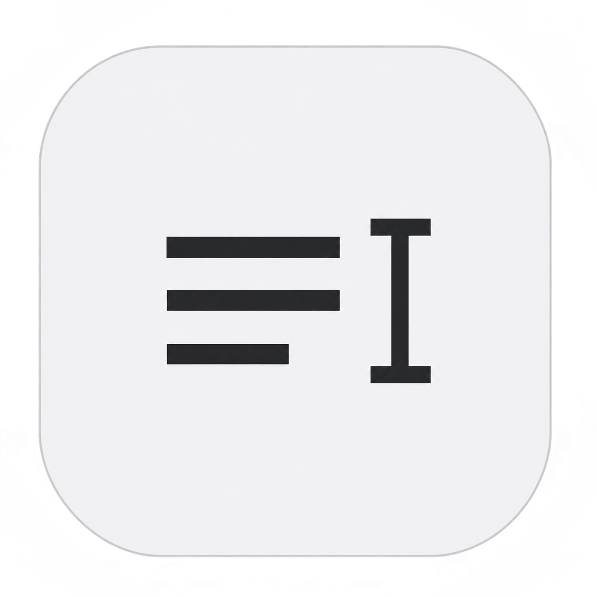
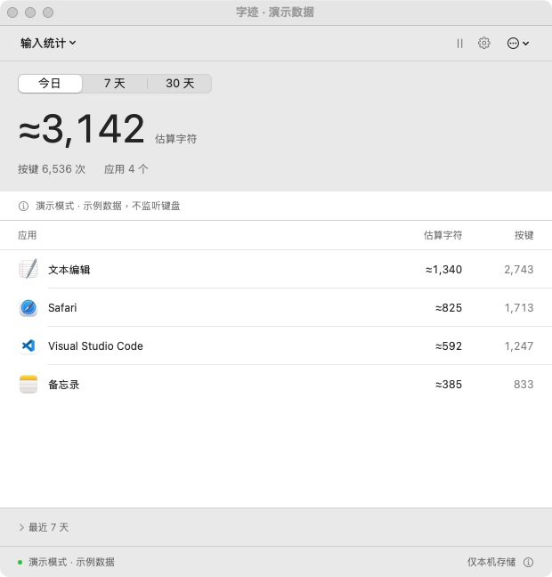
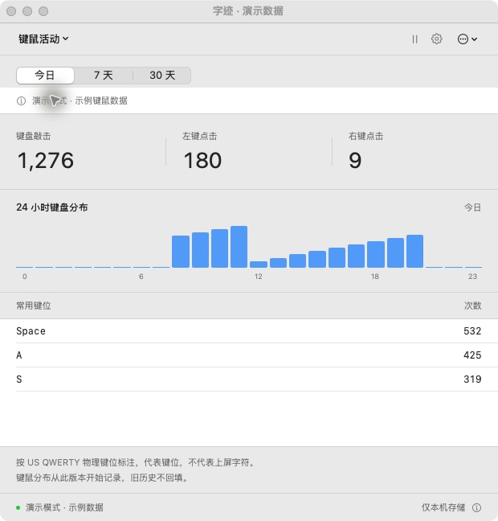

<div align="center">



# 字迹 · TypeCount

**安静地记录，每一次输入。**

一个轻巧的原生 macOS 菜单栏工具，看看今天写了多少，又把文字留在哪些 App 里。

<a href="https://github.com/JonahLee1999/TypeCount/releases/latest"></a>


<a href="LICENSE"></a>

[**下载安装**](https://github.com/JonahLee1999/TypeCount/releases/latest) · [统计与实现](docs/TECHNICAL-NOTES.md) · [更新与发布](docs/UPDATES.md) · [反馈问题](https://github.com/JonahLee1999/TypeCount/issues)

中文 · [English](README.en.md)

</div>

## 少一点界面，多一点专注

菜单栏固定只占一个方形图标位：保留左侧原图标，`1.9k` 这样的紧凑小字位于图标右侧的上半部。可选择字数、按键或鼠标点击数，也可仅显示图标。悬停看完整统计，点击查看明细；关闭窗口后继续在后台记录。

左上角的 **「输入统计 ˅」** 下拉菜单，在输入统计与键鼠活动之间原位切换。默认打开输入统计，两个视图共用日期范围。

<table>
  <tr>
    <td width="50%"></td>
    <td width="50%"></td>
  </tr>
  <tr>
    <td align="center"><b>输入统计</b><br />今日输入、应用明细与近期趋势</td>
    <td align="center"><b>键鼠活动</b><br />键盘敲击、左右点击与活动分布</td>
  </tr>
</table>

<sub>截图来自应用的演示模式，使用示例数据；不含个人输入或真实统计。</sub>

## 日常需要的，刚刚好

| 功能 | 你能看到什么 |
| :--- | :--- |
| 图标与数字角标 | 固定一个图标位，选择今日估算字符、按键、鼠标点击，或仅图标；完整值在悬停提示中查看 |
| 按 App 汇总 | 每个应用的估算新增字符与按键次数，区分文本不可读的应用 |
| 键鼠活动 | 左右键点击、24 小时键盘分布、常用物理键位 |
| 日期与趋势 | 今日、近 7 天、近 30 天；可展开最近 7 天字符趋势 |
| 随时掌控 | 暂停、排除指定应用、导出输入统计 CSV、选择登录时启动 |
| 原生与本地 | SwiftUI / AppKit，跟随系统明暗外观，无账号，统计在本机处理与保存 |
| 应用内更新 | 内置 Sparkle，手动检查 GitHub Releases；自动检查默认关闭，不自动下载更新 |

## 开始使用

**系统要求：macOS 15.6 或更高版本。** DMG 同时支持 Apple Silicon 和 Intel Mac。

1. 从 [Releases](https://github.com/JonahLee1999/TypeCount/releases/latest) 下载最新 `.dmg`，将「字迹」拖入 **Applications**。
2. 弹出磁盘映像，从「应用程序」打开字迹。
3. 在字迹的设置中开启 **辅助功能** 权限，返回应用点击「重新检查」。

辅助功能授权可同时用于键盘监听与支持的编辑框文本读取。只授予「输入监控」时，仅能统计按键。授权由 macOS 管理，字迹不会自动开启系统权限。

> **首次打开提示**
>
> 当前发布包使用本地开发证书签名，尚未经过 Apple Developer ID 签名及公证。其他 Mac 可能提示无法验证开发者。确认来源可信后，可按系统「设置 → 隐私与安全性」提供的「仍要打开」流程确认。受组织管理的设备可能不允许打开。详见 [Apple 的说明](https://developer.apple.com/news/?id=saqachfa)。

需要自启时，在字迹设置中打开 **「登录时启动字迹」**。登录后只常驻菜单栏，不弹出主窗口。

## 更新应用

在应用中选择 **「检查更新…」**，即可通过 HTTPS 检查 GitHub Releases 上的新版本。更新使用 [Sparkle 2.10.1](https://sparkle-project.org/)；默认关闭自动检查和系统信息上报，不自动下载。你可以主动开启自动检查，下载与安装仍由你确认。

确认安装后，更新器替换应用，并让字迹正常退出、重新启动；应用外部的统计文件和设置会保留。没有「检查更新」入口的旧版需要先从 [Releases](https://github.com/JonahLee1999/TypeCount/releases/latest) **手动安装一次含更新器的版本**，之后即可在 App 内更新。

当前本地开发签名及未公证的限制仍然适用。更新不能保证避免系统安全确认或辅助功能重新授权。[更新机制与发布流程 →](docs/UPDATES.md)

## 数字代表什么？

**字符与按键分开计算。** 字符来自当前编辑框的文本变化，按键来自符合统计条件的键盘事件，拼音的每个按键不会直接当作一个汉字。

| 指标 | 统计口径 |
| :--- | :--- |
| 估算字符 | 中文、英文字母、标点、emoji 按 Swift `Character`（字素）计数，忽略空白与换行 |
| 累计新增 | 按可观测变化累计，删除不扣回；切换输入框不计原有内容，未观测到的删除重打或相同内容替换可能漏记 |
| 按键次数 | 包含文本键、删除、回车、Tab 和长按重复；不含 Cmd / Ctrl 快捷键、导航键、功能键及单独修饰键 |
| 物理键位 | 按 US QWERTY 键位标注，展示使用频次，不推断输入内容 |

**继续使用系统拼音或双拼。** 字迹优先读取控件提供的预编辑范围和会话开始、结束通知，结束后延迟读取最终文本。同一编辑框的重复焦点通知、候选点击会保留已有基线。无需更换输入法、安装输入法组件或增加权限。

对缺少提交状态的系统拼音、双拼，疑似拉丁预编辑会先暂存，以避免把 `nihao` 的 5 个临时字符与「你好」的 2 个汉字重复累加。状态未知时，英文混输可能等到新输入的结尾空白或确认提交后才显示；未获确认的内容可能漏记。

**为什么仍然标为估算？** 非连续编辑使用有界差分，减少把两处编辑之间未变化的整段文字重复计入。复杂大段多处编辑超过计算预算时采用保守下界，可能少计。输入法、自动更正、粘贴和不同 App 的文本接口仍可能带来误差，无法保证所有 App 完整、精确。

**已有历史会保留。** 旧记录只有汇总数量，无法反推出此前多计的内容，不会自动重算或清除；新逻辑只影响升级后的新增统计。

**微信为什么没有字数？** 当前测试的微信 4.1.11 没有向辅助功能暴露输入区，因此只能记录按键。已确认不可读时显示「仅按键」，尚未确认时显示「—」，两者都不表示实际输入了 0 个字符。自绘编辑器、终端和远程桌面也可能遇到同样限制。

[查看完整口径、兼容性与权限排查 →](docs/TECHNICAL-NOTES.md#统计口径与准确性)

## 留下数量，不留下文字

所有统计保存在自己的 Mac 上。应用不保存输入原文、按键顺序、剪贴板、截图、鼠标位置或窗口标题，也不上传输入或统计数据。

联网仅用于你手动检查更新、主动开启自动检查，以及确认下载更新时访问 GitHub 与其发布资产服务；不包含遥测，Sparkle 的系统信息上报默认关闭。日常统计无需联网。

为估算字符，当前聚焦编辑框的文本会短暂保留在内存中，并在实际切换到另一编辑框或 App、暂停、排除应用或停止监听时清除。原文和待确认的预编辑内容都不写入存储。系统安全输入和可识别的密码框会跳过；自绘且未标记的密码框无法统一识别，建议手动排除对应 App。

```text
~/Library/Application Support/TypeCount/
├── stats.json       # 按日期、按应用汇总的输入数量
└── activity.json    # 点击计数、无序键位计数与小时桶
```

键鼠分布保留最近 365 天，从启用此功能后开始记录；已有输入历史不会被补造成键位分布。CSV 导出包含输入统计中的日期和应用名称，分享前请自行检查。

## 为常驻而做的取舍

- **事件驱动读取**：由输入、焦点和文本通知触发；提交结束后的延迟补读有次数限制，不做后台空闲轮询。
- **按需刷新界面**：隐藏或关闭窗口后停止列表重建，关闭时释放主窗口。
- **合并保存**：每 5 秒在后台批量原子写入，正常退出时保存最新数据。
- **控制采样范围**：只监听鼠标点击，不监听高频移动；限制文本读取长度与图标缓存。

性能会随前台应用、文档大小与输入方式变化。仓库提供 `scripts/measure-runtime.py`，可在自己的设备上测量进程 CPU 与常驻内存。

## 从源码构建

需要 macOS 和 Xcode。已在 **Xcode 26.3 / Swift 6.2.4 / macOS 15.6.1** 上验证；最低运行版本为 macOS 15.6。

```sh
git clone https://github.com/JonahLee1999/TypeCount.git
cd TypeCount

swift test                         # 核心算法、权限状态与存储测试
./scripts/build-app.sh             # 当前架构的 App
open dist/TypeCount.app
```

通用安装包与演示模式（打包 DMG 另需 Python 3.10+）：

```sh
UNIVERSAL=1 ./scripts/build-app.sh  # arm64 + x86_64
./scripts/build-dmg.sh             # DMG 与 SHA-256 校验文件
./scripts/build-update.sh          # 签名更新包与 appcast，写入 dist/updates/<版本>/
open -n dist/TypeCount.app --args --demo
```

首次 SwiftPM 解析需要联网下载 Sparkle 2.10.1，首次打包 DMG 也需要联网安装 Python 依赖。**Sparkle 是随 App 分发的第三方运行时依赖**（[第三方许可](THIRD-PARTY-NOTICES.md)）；DMG 工具的 Python 依赖只安装到 `.build/dmg-tools`，不随 App 分发。生成更新包另需发布者本机钥匙串中的更新签名密钥，详见 [发布流程](docs/UPDATES.md#发布流程)。

演示模式使用内存中的示例数据，不监听输入、不写入真实统计。

未配置签名身份时，构建脚本使用临时签名，重建可能需要重新授权。可用 `SIGN_IDENTITY` 或本机 `.signing-identity` 设置稳定身份；**不要提交证书、私钥或签名配置**。正式分发需自行完成 Developer ID 签名与 Apple 公证，普通构建脚本不会完成这一步。

## 一起改进

欢迎报告编辑器兼容性、输入法计数问题或提出更轻巧的交互。提交问题时请说明 macOS / App / 输入法版本，并用无敏感内容的文字复现。

[贡献指南](CONTRIBUTING.md) · [报告问题](https://github.com/JonahLee1999/TypeCount/issues/new/choose) · [实现与排查](docs/TECHNICAL-NOTES.md)

感谢 [keyStats](https://github.com/debugtheworldbot/keyStats) 提供键鼠统计方面的功能参考。本项目使用公开系统 API 独立实现，保留对实际输入字符与按键次数的区分。应用内更新由 [Sparkle](https://sparkle-project.org/) 提供。

---

<div align="center">

[MIT License](LICENSE) · Made for macOS

</div>
